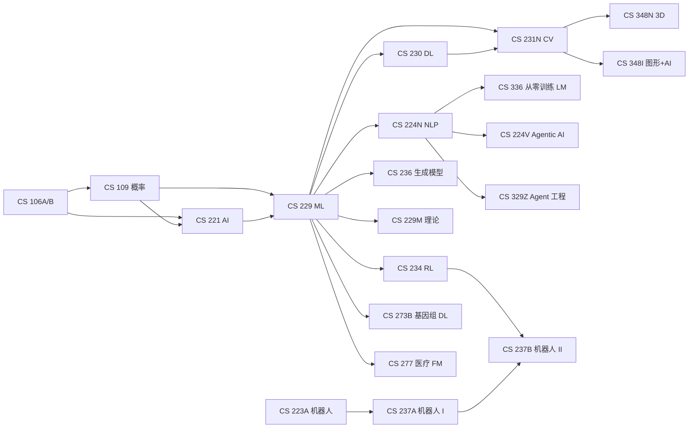

# 学习路径

> 基于 2026–27 学年课程整理。每条路径给出“核心序列 + 选修 + 避坑”，不是官方培养方案；选课前请以 ExploreCourses 和课程官网为准。

## 先修关系总览

---

## 1. LLM / Agent 工程

**目标**：能独立设计、实现、评估一个 LLM 应用或 agent 系统，理解模型能力边界和工程 trade-off。

**核心序列**

| 阶段 | 课程 | 说明 |
| --- | --- | --- |
| 基础 | CS 224N | NLP/LLM 的地基，作业实现 word2vec、RNN、attention |
| 工程 | CS 329Z | 从 LLM pipeline 到 compound AI system，重点是 eval |
| 研究/应用 | CS 224V 或 CS 329A | 224V 偏 agentic AI 方法与项目；329A 偏自我改进研究 |
| 深入 | CS 336 | 从零训练语言模型，理解数据、架构、scaling、部署 |

**推荐选修**

- **CS 329H**：RLHF/偏好学习，理解对齐的数据与目标。
- **CS 329T**：可信 agent 与评估，适合做产品/评测。
- **CS 224G**：sprint 节奏做 LLM App，偏产品。
- **CS 25**：1 学分前沿讲座，低成本跟踪工业界。
- **CS 221M**：机制可解释性，理解模型内部。
- **MS&E 203**：从 0 到 1 做 AI 产品，含 Demo Day。

**一学年怎么排**

- 秋：CS 224N（如果还没修）+ CS 329Z
- 冬：CS 224V 或 CS 329A + CS 329H
- 春：CS 336（需要申请，提前准备 GPU/算力）

**避坑**

- 不要只学 prompt，不学 eval。Agent 的难点是可靠性，不是 demo。
- CS 336 算力消耗大，选课前确认资源。
- 224V/329A/329Z 内容有重叠，按“研究 vs 工程”选，不必全修。

---

## 2. ML 研究 / 读博

**目标**：具备读论文、推公式、设计实验和写论文的能力，找到具体研究方向。

**核心序列**

| 阶段 | 课程 | 说明 |
| --- | --- | --- |
| 地基 | CS 229 | 监督/无监督/学习理论的全景 |
| 理论 | CS 229M 或 STATS 315A | 229M 偏泛化/优化理论；315A 偏统计学习与现代生成模型 |
| 方向 | CS 236 / CS 234 / CS 224W | 生成模型、RL、图学习三选一深入 |
| 研究 | CS 329A / CS 375 / CS 221M | 研究型 seminar + 项目 |

**推荐选修**

- **CS 228**：概率图模型，补结构化不确定性。
- **CS 330**：多任务/元学习。
- **CS 332**：高级 RL。
- **STATS 375 / MATH 276**：数学问题导向的 ML 理论。
- **CS 321M**：AI measurement science，学评估与基准设计。

**避坑**

- CS 229M 数学要求高，先补实分析/概率。
- 不要同时修 229M 和 315A，内容有重叠且都很重。
- 研究型 seminar 的价值在项目和导师关系，不在听课。

---

## 3. CV / 生成 / 3D

**目标**：掌握视觉识别、生成模型、3D 表示与渲染，能做 CV/3D 研究或工程。

**核心序列**

| 阶段 | 课程 | 说明 |
| --- | --- | --- |
| 视觉基础 | CS 231N | 识别、CNN、检测/分割、项目 |
| 生成模型 | CS 236 | VAE/GAN/flow/diffusion 的概率基础 |
| 3D/图形 | CS 348N 或 CS 348I | 3D 神经表示 / 神经渲染 |
| 专题 | CS 468 | 3D/4D 基础模型、几何处理 |

**推荐选修**

- **CS 231A**：相机、立体、SfM，补几何。
- **CS 236G**：GAN 专题。
- **CS 448I**：计算成像、逆问题、端到端光学。
- **CS 348K**：视觉计算系统（图形+系统）。
- **CS 286**：CV + 医疗。

**避坑**

- 231N 和 231A 互补，不是替代；做 3D 建议两门都上。
- 生成模型课程数学味重，先修概率。
- 3D 生成方向论文更新极快，课程只是入口，要自己跟 arXiv。

---

## 4. 机器人 / 具身智能

**目标**：能做机器人的感知、规划、控制和学习，理解 sim-to-real 与硬件约束。

**核心序列**

| 阶段 | 课程 | 说明 |
| --- | --- | --- |
| 机器人基础 | CS 223A | 运动学、动力学、规划、控制 |
| 自主系统 | CS 237A | 感知、SLAM、控制、规划、POMDP、ROS |
| 学习/操作 | CS 237B | RL、操作、模仿学习、人机交互 |
| 具身研究 | CS 381 | sensorimotor learning、论文+项目 |

**推荐选修**

- **CS 225A**：实验机器人，动手做机械臂。
- **CS 227A**：机器人感知，搭 vision-based 系统。
- **CS 234**：RL 基础。
- **CS 231N**：视觉感知。
- **CS 327A / CS 339R**：高级操作 / 协作机器人。
- **CS 345 / CS 123**：更偏动手 build。

**避坑**

- 机器人课普遍重、项目多，一学期不要同时上 223A + 237A + 225A。
- ROS 和仿真环境要提前熟悉。
- 想做具身大模型，RL/视觉/系统三块都要补。

---

## 5. MLSys / 推理基础设施

**目标**：理解训练/推理系统的性能瓶颈，能做分布式训练、推理 serving、编译或加速器。

**核心序列**

| 阶段 | 课程 | 说明 |
| --- | --- | --- |
| 系统视角 | CS 229S 或 CS 329S | ML 系统全栈 / 系统设计 |
| 推理 | CS 349D 或 CS 349E | 推理基础设施 / 高效推理 |
| 硬件 | CS 217 | AI 加速器、数据流、存储层次 |

**推荐选修**

- **CS 349F**：AI 集群网络 fabric。
- **CS 149**：并行计算。
- **CS 349H**：新硬件软件技术。
- **CS 336**：理解模型训练的实际开销。
- **MS&E 319**：高效生成模型的算法 trade-off。

**避坑**

- 系统课需要体系结构/OS/网络基础，不要直接跳 349E。
- 349D/E/F 内容互补但都偏研究，按方向选。
- 性能课一定要动手跑 benchmark，只看论文不够。

---

## 6. AI4Science / 医疗

**目标**：把 ML 方法落到具体科学/临床问题，理解数据、评估和领域约束。

**核心序列**

| 阶段 | 课程 | 说明 |
| --- | --- | --- |
| ML 基础 | CS 229 | 监督/无监督/评估 |
| 领域入口 | CS 273B 或 CS 279 | 基因组 DL / 计算生物 |
| 医疗 FM | CS 277 或 CS 287 | 医疗基础模型 / data-centric AI |
| 前沿 | EE 292R | AI4Science 讲座，扫版图 |

**推荐选修**

- **CS 286**：CV + 生物医学进阶。
- **CS 375**：NeuroAI，大脑与网络对应。
- **CS 322**：神经科学、心理学与 AI 三角互证。
- **STATS 326**：蛋白生成模型。
- **CS 270 / CS 271**：生物医学建模 / 医疗算法基础。

**避坑**

- 医疗 AI 的瓶颈常常是数据而不是模型，优先补 CS 287 的视角。
- 不要只看 benchmark，临床评估指标不同。
- AI4Science 跨度大，先选一个领域（生物/神经/化学）深入。

---

## 组合建议

- **LLM + 系统**：CS 224N → CS 329Z → CS 336 → CS 349E，适合做推理/训练基础设施。
- **CV + 机器人**：CS 231N → CS 223A → CS 237A → CS 227A/CS 381，适合具身智能。
- **ML + 医疗**：CS 229 → CS 273B → CS 277 → CS 287，适合医疗 AI。
- **理论 + 生成**：CS 229 → CS 229M → CS 236 → STATS 315A，适合读博。

选课不是集邮：每学期 2–3 门硬课 + 1 门轻课（seminar/产品课）通常比 4 门硬课更可持续。
